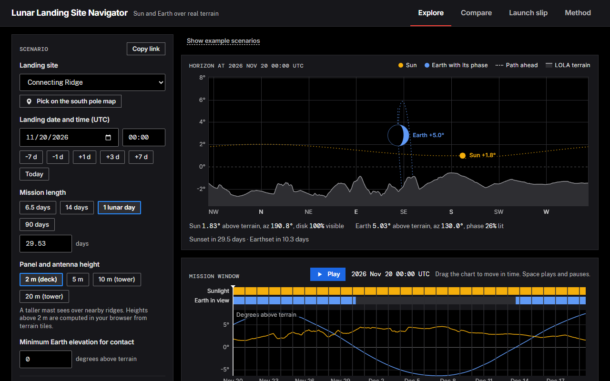
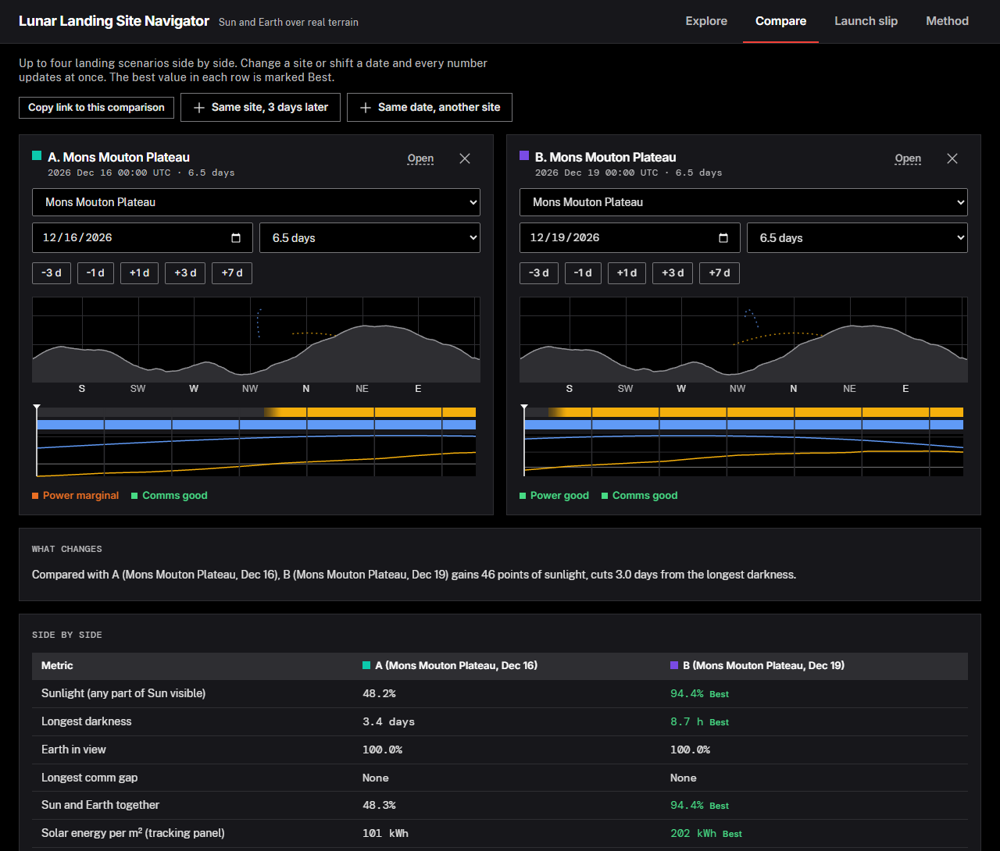

# Lunar Landing Site Navigator

Compare lunar landing sites and dates by what matters most at the south pole: can the lander see the Sun, and can it see Earth? The app draws the Sun and Earth against the real terrain horizon for any site and time, measures sunlight and direct-to-Earth visibility over a mission window, and puts scenarios side by side so a slipped launch or a new site can be judged in seconds.

**Live app: https://shackleton-ridge.netlify.app** (runs in any modern browser, nothing to install)

Built for the NASA Space Apps Challenge 2026, challenge "Lunar Landing Site Navigator", by team Shackleton Ridge. Not an official NASA website.





Demo video: [demo/demo.mp4](demo/demo.mp4), 29.8 seconds, 1920x1080, on-screen text burned in, no sound. It is a screen recording of the app, cut together with AI assistance and marked as such in the corner.

## What you can do

- **Explore** one scenario: pick a site (28 curated sites or your own coordinates), a landing date and time (UTC) and a mission length. See the horizon panorama with the terrain silhouette, the Sun and Earth (with its phase) and their paths, a timeline of sunlight and Earth view, time to the next sunset or Earthset, and power and contact metrics. Press Play to watch the window.
- **Start here**: four real cases to open with one click, found by scanning every landing date from November 2026 to November 2027. For example, at the Mons Mouton Plateau candidate region a three-day slip doubles the sunlight of a 6.5-day crewed stay.
- **Mast height**: raise the panels and antenna from 2 m to 5, 10 or 20 m and see how much a tower gains over nearby ridges.
- **Power budget**: enter panel area, efficiency and load; the app sizes the smallest battery that gets through the window and plots its charge.
- **Events and export**: every sunrise, sunset, Earthrise and Earthset in the window with UTC times, and CSV downloads of the events and the full timeline.
- **Better spot nearby**: scans a grid of up to 49 points within 1, 2 or 5 km of the site, computes each horizon in your browser, and ranks them for power, contact or both. At the Mons Mouton Plateau point, landing on 16 December 2026, moving 0.5 km north raises sunlight from 53% to 100%.
- **Compare** up to four scenarios side by side. Shift a date by a day or swap a site and every number updates. The best value in each row is highlighted, and a plain sentence says what changed.
- **Launch slip**: scan 30 to 365 days of possible landing times at one site and rank them by power, contact or both.
- **Map**: a south pole map from LOLA terrain with NASA's 18.6-year sunlight and Earth visibility maps as overlays. Click anywhere south of 80.5 S and the browser computes that point's terrain horizon in about a quarter of a second.
- **Quick controls**: Previous and Next event buttons and 0.5x to 4x playback. Keys: Space plays, the arrow keys step an hour (Shift for a day), [ and ] jump between sunrises, sunsets, Earthrises and Earthsets. The cursor time also shows in your own time zone.
- **Share**: every scenario lives in the page link. Copy link shares exactly what you see, including comparisons and mast height.
- **Method**: how it works, the limits, and all four validation checks below, including a comparison with JPL Horizons that runs live in your browser.

## How it works

1. **Sun and Earth positions.** NASA NAIF SPICE with the DE440 ephemeris and DE440 lunar orientation kernels gives the apparent position (light time and stellar aberration) of the Sun and Earth from the Moon's centre in the MOON_ME frame. The pipeline stores these every 2 hours for 1969 to 1972, 2013, 2019, 2020 and 2023 to 2035 (about 100 KB per year). The browser interpolates them with a cubic polynomial and computes topocentric azimuth and elevation for any latitude and longitude, including parallax.
2. **Terrain horizons.** From each site the pipeline marches along 720 directions over NASA LRO LOLA elevation models (Barker et al. 2023): 20 m near the site (read by HTTP range requests from the cloud-optimized GeoTIFF), 80 m out to 60 km and 240 m out to 250 km, keeping the highest elevation angle including the curvature of the Moon. The observer is 2 m above the ground. For custom points the same algorithm runs in a Web Worker on compact terrain tiles (80 m, 240 m, 960 m).
3. **Metrics.** Sunlight is the share of time any part of the solar disk is above the terrain. Power assumes a sun-tracking panel, 1361 W/m² at 1 AU, scaled by the visible fraction of the disk. Earth is in view when its centre is above the terrain plus an optional minimum elevation.

## Validation

| Check | Result |
|---|---|
| Sun and Earth azimuth and elevation vs JPL Horizons, 832 values at 6 sites (2026, 2028 and the Apollo 11 landing) | largest difference 0.0002° in elevation, 0.00003° in azimuth |
| Terrain sunlight vs Gläser et al. 2018 (20 m LOLA, hourly 2017 to 2037), 5 published points | 4 points within about 1 percentage point, 1 within 2.6 |
| 18.6-year Sun and Earth visibility vs NASA PGDA maps (Mazarico et al. 2011) at 14 polar sites | Earth median difference 0.5 points, Sun 3.1 points; close agreement on broad terrain, larger differences on sharp peaks where our 20 m near field resolves slopes that 120 m pixels average out. The map reads 0 at the exact pole, so that site is left out. |
| Browser terrain (80/240/960 m) vs pipeline terrain (20 m near field) at 15 polar sites | median RMS difference 0.2°, up to about 1° on steep rims |

Site heights from the terrain model also match published values: Odysseus 2592 m (published 2579 m), Chandrayaan-3 530 m (published 532 m).

## Limits

- Terrain is modeled only from 60° S to the pole. Other sites use a smooth horizon and are labeled.
- LOLA elevation errors of metres to tens of metres can move sunrise or sunset by hours when the Sun grazes the horizon.
- The lander itself, its shadow, and boulders smaller than the terrain grid are not modeled.
- NASA has not published coordinates for its candidate landing regions; region points here are centres of LROC image mosaics and are approximate.
- Earth view is line of sight only. It does not model ground station schedules or relay satellites.
- This is a planning aid built in a weekend, not a flight tool.

## Run it locally

Web app (Node 20):

```bash
cd web
npm install
npm run dev
```

Tests (geometry against the frozen Horizons values):

```bash
cd web
npm test
```

The data the app needs is already in `web/public/data`. To rebuild it, set up Python 3.12 and run the pipeline:

```bash
python -m venv .venv
.venv/Scripts/pip install -r pipeline/requirements.txt
```

Then download the SPICE kernels listed in `pipeline/common.py` into `data/raw/kernels`, the LOLA DEMs `LDEM_80S_80MPP_ADJ.TIF` and `LDEM_60S_240MPP_ADJ.TIF` from https://pgda.gsfc.nasa.gov/products/90 into `data/raw/dem`, and the PGDA illumination maps `AVGVISIB_75S_120M_201608.TIF` and `AVGVISIB_75S_120M_201608_EARTH.TIF` from https://pgda.gsfc.nasa.gov/products/69 into `data/raw/illum`. From `pipeline/` run `build_ephemeris.py`, `fetch_horizons.py`, `build_sites.py`, `build_tiles.py`, `build_basemap.py` and `build_overlays.py`. The validation scripts are `check_spice_vs_horizons.py`, `validate_illumination.py`, `compare_pgda.py` and `check_tile_masks.py`.

## Data and credits

- NASA NAIF SPICE toolkit and generic kernels (DE440 ephemeris, lunar orientation and frame kernels), via SpiceyPy.
- JPL Horizons System, for validation.
- NASA LRO LOLA south pole elevation models: Barker, M. K. et al. 2023, Planetary Science Journal 4, 183, doi:10.3847/PSJ/acf3e1; data doi:10.60903/gsfcpgda-lola-spole (NASA GSFC PGDA).
- NASA LRO LOLA lunar polar illumination maps: Mazarico, E. et al. 2011, Icarus 211, 1066, doi:10.1016/j.icarus.2010.10.030 (NASA GSFC PGDA product 69).
- Validation and site sources: Gläser et al. 2018 (PSS 162), Bussey et al. 2010 (Icarus 208), De Rosa et al. 2012 (PSS 74), NSSDCA lunar artifact table, LROC images and mosaics (NASA/GSFC/Arizona State University), IAU Gazetteer of Planetary Nomenclature, NASA news releases.
- Software: React, Vite, TypeScript, Leaflet, Vitest; NumPy, SciPy, Numba, Rasterio, pyproj, Pillow, Requests.
- Design: built on the NASA Horizon Design System (HDS Core, https://github.com/nasa/hds-core, public domain): its color roles, type roles, spacing and icons. No NASA insignia, logotype or seal is used, and the project is not affiliated with or endorsed by NASA. Fonts: Inter and DM Mono (SIL Open Font License 1.1), Public Sans (SIL Open Font License 1.1, with public domain changes by GSA). License texts ship in `web/public/licenses`.

The full list is in [REFERENCES.md](REFERENCES.md).

## Use of AI

The code and text in this repository were written with help from Claude, an AI model by Anthropic, under the direction of the team, and reviewed and tested by the team. All numbers in the app come from NASA data and the validation above, not from an AI model. The demo video is a screen recording of the app; the scripts that record and cut it were written with Claude, so the video carries a visible "Made with AI assistance" mark. No AI image, video or voice generator was used.

## License

Code: MIT (see LICENSE). NASA data products remain under their original terms; please cite them as listed above.
